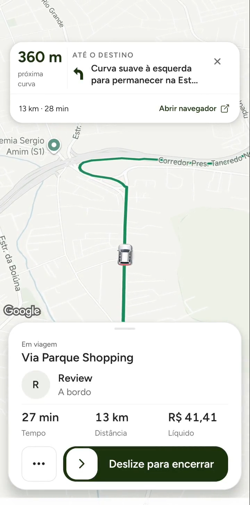
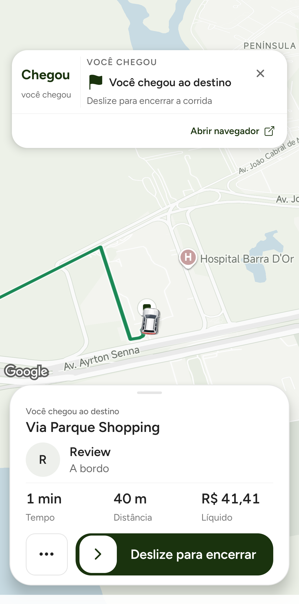
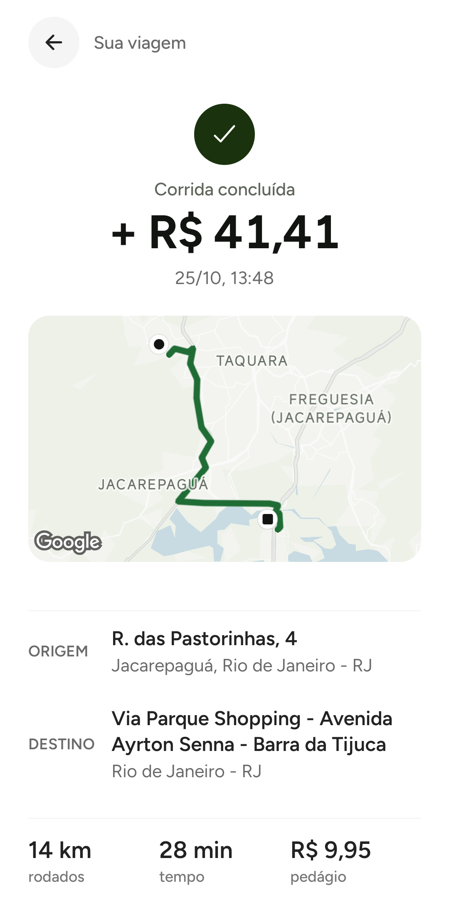

# QA final da câmera do motorista — 25/10/2026

## Objetivo e resultado

Limpar a corrida sandbox interrompida pela desconexão USB e repetir o E2E nos aparelhos físicos para conferir a câmera durante a busca e a viagem. **Fluxo da nova corrida concluído no destino, recibos conferidos e limpeza final confirmada.** A apresentação observada mantém o carro inteiro sobre a rota, espaço à frente entre os cards e perspectiva de condução. **Não aprovar como melhoria comprovada de fluidez/60 fps:** as medições variaram e não houve comparação controlada com a câmera plana.

Xiaomi motorista, Android 1.0.11 (144), APK local SHA-256 `9c7fba631f386b13c660a52139c088c7c7d8ce2adb43e019d0d34213b4d95b56`, OTA desativada; iPhone passageiro com sessão QA existente. Código da câmera igual a `96e314230`; esta rodada só acrescenta documentação/evidências. Não houve publicação, novo build nativo ou mudança de regra.

## Limpeza da rodada anterior

A corrida `booking_1792925169808_3tEQ8pQ2QzeWbMKhLGsXHHhnOGL2` continuava IN_PROGRESS. GPS mock parado; encerramento antecipado feito pela UI do motorista, com confirmação de consentimento pelo perfil passageiro QA. Backend COMPLETED/EARLY_ENDED_BY_DRIVER; contador permaneceu em 8, sem reserva inflight. Valor final R$ 11,75, líquido R$ 10,26, Leaf R$ 0,99 e Pix R$ 0,50; estorno parcial sandbox R$ 31,68 sobre R$ 43,43 pagos. Settlement de 1.175 centavos e refund de 3.168 centavos posted e balanceados. Sem escrita manual em estado financeiro. Às 13:19:09 de São Paulo, ambos os perfis estavam sem corrida ativa e a janela antiga ausente.

O app exibiu alerta de indisponibilidade após o encerramento, embora o backend já tivesse finalizado e emitido recibo. Esse problema de confirmação/conexão não foi corrigido pela câmera; permanece risco separado.

## Nova corrida completa

Autorização de Izaak: limpar e rodar novamente. Nova janela QA limitada aos perfis existentes, expiração 14:19:33 de São Paulo. Uma tentativa de destino curto (Praça da Merck) foi bloqueada como fora da área antes do pedido; cobertura respeitada. Em seguida foi usada a rota conhecida ao Via Parque. Houve essa busca adicional de destino pelos gatilhos normais; nenhum miss foi forçado ou chamada feita diretamente ao Google.

- Pedido `booking_1792945342893_3tEQ8pQ2QzeWbMKhLGsXHHhnOGL2`, Pix **sandbox R$ 42,90**, confirmado uma vez. Aceite na primeira oferta, 13:22:29.
- Aproximação: replay de aproximadamente 409 m da geometria já existente em direção ao embarque, GPS QA 1 Hz. Chegada aceita a cerca de 10 m; estado ARRIVED. Confirmação das ações apresentou demora; não houve repetição cega do pagamento.
- Início confirmado às 13:25:08, IN_PROGRESS. Preferência existente abriu navegador externo no aceite/início; Leaf trazido de volta sem operar outros apps.
- Viagem: replay de todos os 653 pontos da geometria desta solicitação, interpolados em 918 fixes de GPS, 1 Hz, velocidade nominal 20 m/s, sem pular para o destino. O serviço manteve a última posição após terminar. O carro permaneceu visível nos registros; gesto manual e retomada do acompanhamento registrados em capturas.
- Às 13:47, Leaf reconhecia a chegada, cerca de 40 m do destino selecionado (ponto final da via navegável). Encerramento pelo slider, confirmado às **13:48:01**. Backend COMPLETED, `SERVER_DESTINATION_COMPLETION`, sem encerramento antecipado.
- Contador sandbox **8 → 9**, Redis e Firestore; ID aparece uma vez no histórico durável. Operacional permanece **0** em ambos. Não valida a primeira corrida operacional com passageiro/Pix reais.

[Vídeo da aproximação, 12 s](evidence/navigation-camera-rerun-pickup-2026-10-25.mp4) · [Vídeo em viagem, 12 s](evidence/navigation-camera-rerun-trip-2026-10-25.mp4). Ambos são gravações do Leaf físico, recortadas apenas para remover barras do sistema; não são mockups. Gravação fora das janelas de desempenho.

## Recibos, ledger e limpeza

Recibo passageiro: R$ 42,90 brutos. Recibo motorista: R$ 41,41 líquidos, pedágio explícito de R$ 9,95. Snapshot backend: Leaf R$ 0,99, Pix R$ 0,50, alocação 4.290 centavos balanceada. Um evento `ride_settlement` posted, débito = crédito = 4.290 centavos. A indicação `credited:false` do documento de pagamento e `paymentStatus:in_holding` da hash persistem; estas flags isoladas não foram tratadas como comprovação de payout. A validação aqui é de recibo/snapshot/ledger/counter, sem saque ou auditoria completa do saldo.

Às **13:49:11 de São Paulo**, consulta final confirmou motorista offline, ambos sem corrida ativa, janela própria removida por compare-and-delete, nenhuma janela alheia removida. Loop GPS encerrou e serviço mock ausente no dumpsys. Passageiro no início, sessões preservadas. Sem pm clear, desinstalação, senha/OTP ou alteração de configuração do aparelho.

## Desempenho observado

Mesmo processo Leaf, modo de tela de 120 Hz observado pelo período nativo 8.333.333 ns; sem forçar taxa ou alterar configuração. Cinco janelas completas de aproximadamente 20 s, sem gravação/captura Android dentro da medição:

| Janela | CPU (% de um núcleo) | Frames com atraso / total | p95 gfxinfo |
| --- | --- | --- | --- |
| Aproximação | 151,0% | 100/981 (10,2%) | 20 ms |
| Viagem inicial | 159,3% | 81/966 (8,4%) | 19 ms |
| Viagem seguinte | 171,0% | 121/1025 (11,8%) | 21 ms |
| Viagem seguinte | 168,5% | 125/1023 (12,2%) | 21 ms |
| Viagem intermediária | 177,0% | 97/1128 (8,6%) | 20 ms |

A amostra `trip-01` foi interrompida antes de confirmar início/movimento e **descartada**, não entra na tabela. Não comparar diretamente com a primeira rodada (p95 13–14 ms), nem com o estudo antigo a 60 Hz: condições, fase, processo aquecido e horários diferem. Dados mostram que atraso de frames continua presente. Gfxinfo não cobre todo o trabalho da superfície/GPU do Google Maps; ring buffer de framestats veio vazio, então os dados são dos contadores agregados. CPU pode superar 100% por representar múltiplos núcleos. RSS por janela variou aproximadamente entre 391 e 432 MiB; não comprova estabilidade de memória nem vazamento. Sem ensaio de bateria/temperatura ou baseline para atribuir custo incremental aos 40°.

A telemetria desta corrida registrou zero requests Google/directions atribuídos; como cobertura da instrumentação não foi auditada aqui, **não é prova de faturamento zero ou da contagem total de APIs**. A câmera não adiciona chamadas no código. Não foram forçadas reconsultas ou caches miss para o QA.

## Testes, riscos, reversão e fora do escopo

Nesta retomada: E2E físico sandbox, replay completo da geometria, capturas/vídeos, cinco janelas de desempenho, recibos, ledger, contador e limpeza. Governança, guards mobile de produção, scan de segredos, secret guard e diff check executados ao registrar a evidência. A suíte mobile anterior permanece 229 suítes/1.857 testes; código não mudou nesta rodada.

**Aceitação:** comportamento visual e ciclo sandbox comprovados neste Xiaomi; desempenho sem aprovação como ganho de fluidez. Confirmação lenta/reconexões observadas; câmera do iPhone motorista, outras densidades, autonomia e GPS em veículo real não validados. A chegada/recibo com duração comercial exibida não é medição real de deslocamento: GPS foi simulado e houve espera no destino.

Arquivos desta retomada: este relatório, atualização de status do relatório anterior, JSON resumido e mídia em `docs/validation/evidence/navigation-camera-rerun-*`. [Resumo verificável](evidence/navigation-camera-rerun-summary-2026-10-25.json). Artefatos brutos restritos a QA estão fora do Git em `~/.codex/visualizations/2026/10/22/01a16498-a3ec-7093-bfae-c4c373c52628/driver-camera-rerun-2026-10-25/`.

Rollback: reverter o commit de câmera `96e314230`, preservando carrinho/cards; APK anterior local guardado como `before-camera.apk`, sem apagar dados. Fora do escopo, sem alteração: restante da interface, passageiro, banner externo, backend/socket, finanças/KYC, frequência de provedores, merge, deploy, OTA, Sentry e lojas. **Não houve autorização/publicação em produção.**
