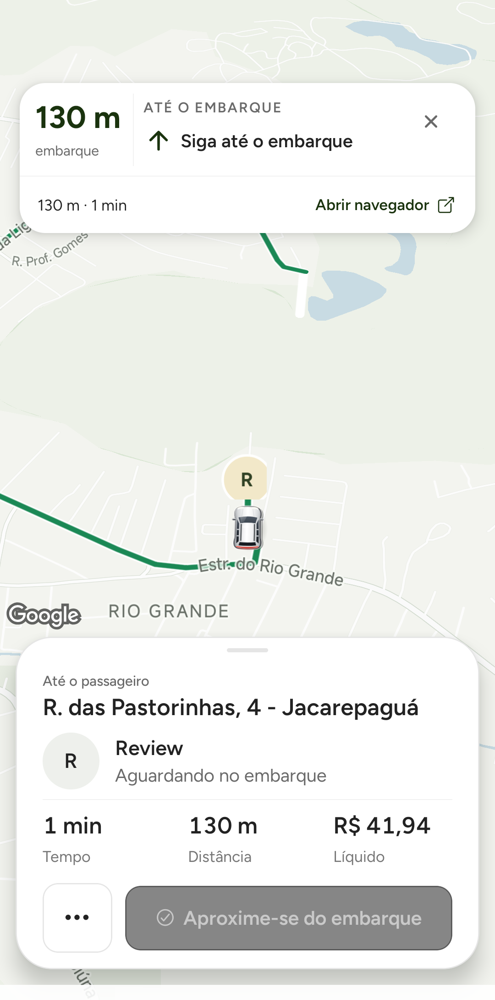
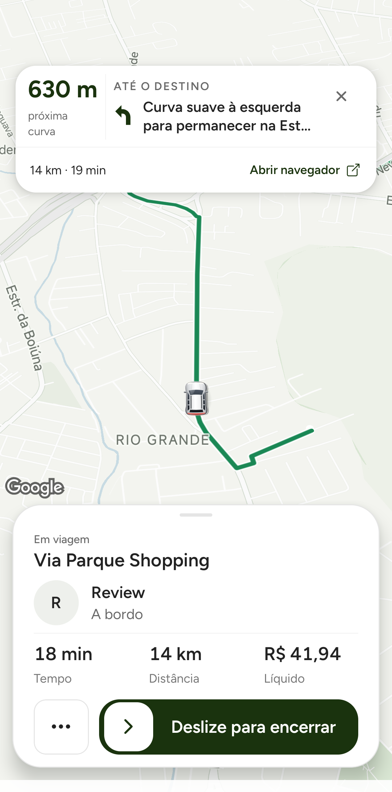

# Câmera de navegação do motorista com perspectiva

**Estado atual em 25/10:** a limpeza e a nova rodada E2E foram concluídas; ver [relatório final](DRIVER_CAMERA_E2E_2026-10-25.md). As seções abaixo preservam o registro histórico de preparação e interrupção, cujas pendências de corrida/limpeza já foram resolvidas. Desempenho continua sem aprovação de fluidez para publicação.

## Objetivo e escopo concluído no código

Pedido adicional de Izaak: visualização de condução parecida com a do Waze, tanto indo buscar (`accepted`) quanto durante a corrida (`started`), mantendo Google Maps e as instruções visuais existentes. Implementação após `75bd63bd5`, que corrigiu o carro cortado e compactou os cards.

- Inclinação fixa de **40°** no acompanhamento do motorista; não varia com ruído de velocidade.
- Direção da rota para cima, usando o heading suavizado já existente.
- Carro em **72% da área útil vertical entre os cards**, alinhado horizontalmente ao centro.
- Enquadramento por padding nativo do Google Maps. O centro geográfico da câmera fica no motorista; foi substituído o deslocamento geográfico calculado para uma câmera plana, que ficaria incorreto com perspectiva e duplicaria o deslocamento.
- Zoom/faixas de velocidade, histerese, atualização de câmera de 800 ms, limiares de deslocamento/heading, pausa por interação manual, suspensão em segundo plano e breve visão geral da rota permanecem. A visão geral não usa o padding de acompanhamento.
- Padding especial restrito ao perfil motorista. Passageiro/preview/espera conservam o caminho existente; o gesto manual de inclinar continua desabilitado. Não inclui Navigation SDK, voz, novos provedores ou chamadas Routes/Places.

O Google documenta que o alvo da câmera corresponde ao centro da região com padding, inclusive para os movimentos programáticos. A área total continua sendo desenhada. [Documentação do Maps SDK](https://developers.google.com/maps/documentation/android-sdk/configure-map#map_padding). A regra de layout implementada usa esse comportamento; ainda exige conferir a apresentação no aparelho inclinado.

## Arquivos alterados

`LeafNativeNavigationEngine.js` (pitch/âncora/cálculo puro de padding), `RobotaxiHomeScreen.js` (segue o alvo com padding e remove compensação plana), `PrototypeMapLayer.js` (prioridade do padding de navegação apenas no motorista). Testes: `leaf-native-navigation-engine`, `driver-online-toggle`, `prototype-map-layer-viewport` e `prototype-reduced-motion`.

## Testes executados e evidência

- **229 suítes / 1.857 testes passaram** na suíte mobile completa; log `/tmp/leaf-driver-perspective-full-tests.log`. Comando `npm --prefix mobile-app run test:unit -- --watchman=false --resolver=<resolver local de QA existente> --runInBand`.
- Testes focados: 150 passaram. Cobrem geometria da âncora com alturas/oclusões diferentes, padding finito em layouts apertados, perspectiva fixa com velocidades distintas, ambas as fases ativas, prioridade do padding no motorista Android/iOS e preservação do preview do passageiro.
- Governança, guards mobile de produção, secret scan rastreado, secret guard backend e diff check passaram. No CI de `96e314230`, mobile completo, backend, regras Firebase e segurança passaram. Dashboard falhou antes de lint/build/smoke: `Playwright does not support chromium on ubuntu26.04-x64`. [Execução](https://github.com/leaf-admin/Leaf-new/actions/runs/40156593004).
- **Ainda não há captura física da câmera a 40°.** A imagem em `DRIVER_NAVIGATION_VISIBILITY_2026-10-24.md` foi feita em `75bd63bd5`, com câmera plana: comprova o carrinho/cards anteriores e não deve ser apresentada como evidência desta perspectiva.

## QA pendente, riscos e reversão

Os dois pedidos sandbox do ciclo autorizado anterior já foram concluídos. Nova corrida para validar esta mudança precisa de autorização específica para uso das credenciais/perfis QA, Pix sandbox e até duas rotas/uma busca pelos gatilhos normais, sem forçar misses. Janela temporária somente se necessária e removida ao finalizar. Não há autorização de publicação nesta tarefa.

O volume externo de build está desconectado. Pacote local preparado em `~/.codex/visualizations/2026/10/22/01a16498-a3ec-7093-bfae-c4c373c52628/driver-camera-perspective-2026-10-24/driver-camera-qa.apk`, usando cópia das fontes e dependências locais/versões do lockfile, fora do produto. O pacote do SDK Updates já declarado foi recuperado do cache npm local; nenhum manifesto/lockfile foi alterado. O resolver local mantém uma instância de React/RN; um plugin de assets somente de QA preserva os nomes de recursos compilados da base, evitando perder fontes/ícones devido aos caminhos de outro diretório. Sem patch no código ou nos recursos nativos.

APK SHA-256 `b5529d4ff43c84726a1005ca19ce1a9d9fc99540985991c27eb525f34e3769aa`; bundle `bc297a5401acee4a703e45ead66ca061267738e54afb0ce1c86e69b57fdf23d9`. Base guardada `before-camera.apk`, SHA-256 `5191dbff903ed1b9c14ee61c31859ba7b75cb494840c2cce02edc33659653b24`. Verificações confirmaram mesmo certificado QA, mesma versão do bytecode Hermes, mesmos 43 DEX/bibliotecas nativas e bytes iguais em todos os arquivos conservados fora do bundle/assinatura. OTA desativada. Nenhum APK desta perspectiva foi instalado; o pacote ainda precisa do smoke/QA autorizados.

Limites: perspectiva pode mudar legibilidade, foreshortening do carro e custo de renderização nativa; não há alegação de ganho de FPS/autonomia. Redimensionamento dos cards precisa ser conferido com a câmera inclinada. O problema de conexão observado no QA anterior não foi alterado. PR deve permanecer sem aprovação visual para publicação até o QA.

Reversão: reverter somente o commit da perspectiva para restaurar câmera plana e a compensação anterior, preservando o commit do carrinho/cards. Fora do escopo: passageiro, banner externo, regras financeiras/KYC, backend/socket, frequência de provedores, deploy, OTA, Sentry e lojas.

## Pré-voo físico autorizado em 25/10 — E2E ainda não iniciado

Izaak autorizou uma nova corrida sandbox, limitada aos mesmos dois perfis, até duas rotas e uma busca pelos gatilhos normais, Pix sandbox e janela temporária apenas se necessária. A autorização ainda não foi consumida por uma solicitação. O pré-voo às 05:44Z confirmou motorista offline, nenhum dos dois perfis com corrida ativa, contador sandbox 8 e operacional 0. Nenhuma janela foi renovada, pedido criado ou pagamento confirmado nesta rodada.

O APK inicialmente preparado (`b5529d4…`) foi instalado, mas falhou no bootstrap (`queueMicrotask` ausente). A causa foi o serializer Metro local: o caminho do módulo de inicialização RN apontava para uma árvore diferente daquela resolvida no bundle. A configuração **fora do repositório** passou a preservar os módulos de pré-inicialização RN e Expo com seus caminhos reais. Nenhuma fonte do produto, dependência ou recurso nativo foi alterado. O erro inicial não é evidência de falha da câmera.

Pacote corrigido e instalado: APK SHA-256 `9c7fba631f386b13c660a52139c088c7c7d8ce2adb43e019d0d34213b4d95b56`; bundle `d94c0f43372ca45d4e1d3f4db3c8e9427f862415683c81f2501f44dc8818d269`. Mesmos 43 arquivos DEX/SO, certificado QA e base anterior; bytes conservados fora de JS/assinatura conferidos novamente. O log de nova inicialização não repetiu o erro anterior. **Smoke visual e câmera em navegação continuam pendentes.**

Bloqueio físico: Xiaomi bloqueado por inatividade; o runner do iPhone falhou ao habilitar automação com “Autenticação cancelada”. Solicitado ao proprietário desbloquear os dois e deixá-los no Leaf; nenhuma senha/OTP foi acessada. Não há captura nova de navegação, medida de desempenho ou conclusão E2E desta perspectiva. O próximo passo é conferir o carregamento visual e executar a única corrida já autorizada, registrando ambos os trechos e a limpeza final. Reversão local disponível em `before-camera.apk`, sem apagar dados.

## QA físico em 25/10 — evidência parcial, corrida ainda aberta

Após desbloqueio dos aparelhos, o bundle corrigido abriu o Leaf com sessão preservada. Pré-voo às 10:44Z confirmou nenhuma corrida ativa e contador sandbox 8/operacional 0. Janela QA renovada somente para o motorista autorizado até `2026-10-25T11:45:05.772Z`.

Uma solicitação, `booking_1792925169808_3tEQ8pQ2QzeWbMKhLGsXHHhnOGL2`, Pix sandbox R$ 43,43, destino Via Parque Shopping. A primeira oferta expirou antes do toque; o mesmo pedido foi redistribuído, sem novo pagamento, e aceito às 10:48:04Z. No aceite e no início o app abriu o navegador externo conforme a preferência existente; Leaf foi trazido de volta, sem operar o navegador. Chegada aceita com GPS QA a aproximadamente 8 m do embarque; servidor `ARRIVED`. Início às 10:52:14Z, servidor `IN_PROGRESS`.

Capturas físicas mostram a perspectiva configurada a 40° nas fases accepted/started, carro inteiro e espaço à frente entre os cards. Gesto manual deslocou a câmera; captura posterior mostra retomada do acompanhamento. Não é reprodução do Waze nem validação da câmera no iPhone motorista: o iPhone está como passageiro. A aproximação utilizou replay de ~409 m da geometria existente, em sentido de aproximação, após reposicionar o GPS QA; não é uma trajetória real de deslocamento do aparelho. O início da viagem usou a geometria da própria solicitação, GPS 1 Hz.

Três janelas completas, sem captura de tela Android dentro da medição:

| Janela | Duração | CPU (% de um núcleo) | Frames janky / total | p95 gfxinfo |
| --- | --- | --- | --- | --- |
| Aproximação inicial | 20,29 s | 122,6% | 13/898 | 14 ms |
| Aproximação final (inclui parada) | 20,33 s | 80,3% | 6/618 | 13 ms |
| Em viagem, trecho inicial | 20,29 s | 115,2% | 7/980 | 14 ms |

**Não há comparação controlada antes/depois nesta rodada.** Velocidades/fases distintas, janelas curtas; o gfxinfo não cobre toda a superfície/GPU do Google Maps. Sem alegação de melhoria de FPS, bateria ou ausência de regressão sustentada. Valores acima de 100% de CPU representam uso agregado de mais de um núcleo.

Às ~10:53Z o Xiaomi desapareceu do ADB. O replay GPS encerrou com erro de dispositivo ausente e não pôde confirmar a parada do serviço mock. A segunda amostra em viagem (`trip-perspective-02`) foi interrompida e está **descartada**, sem métricas finais. Às 10:54:11Z o backend ainda registrava a mesma corrida `IN_PROGRESS`, contador sandbox 8 com reserva inflight e operacional 0. Solicitada reconexão do cabo, aparelho desbloqueado no Leaf.

**Pendente:** retomar e encerrar essa corrida pelo fluxo normal, conferir recibo/ledger/contador, colocar motorista offline, parar serviço GPS e remover somente a janela criada por esta rodada. Não há publicação nem nova solicitação autorizada. Evidência local: `driver-camera-perspective-2026-10-24/{performance-valid-windows.json,usb-interrupted.json,payment-confirmation.log}`; fontes do produto permanecem iguais a `96e314230`.
