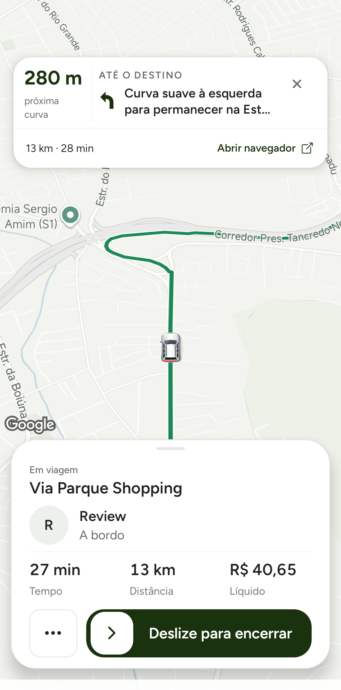
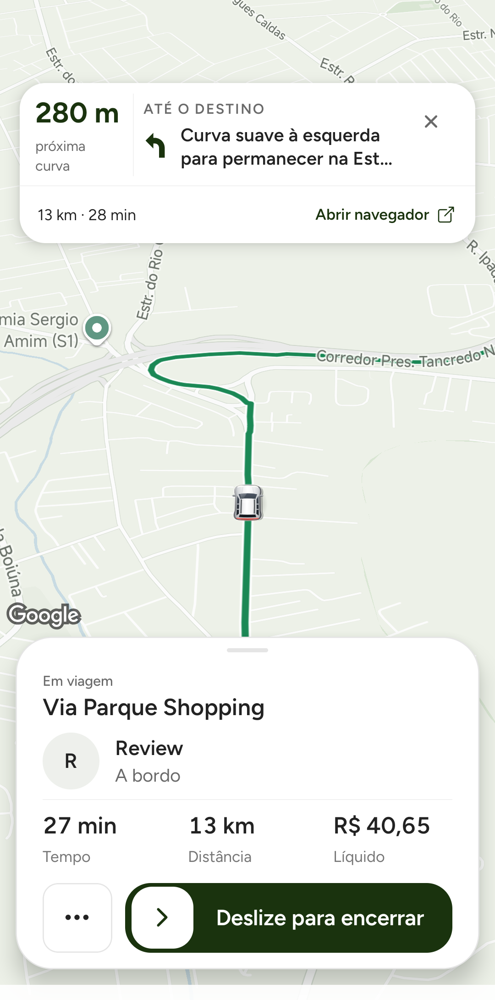
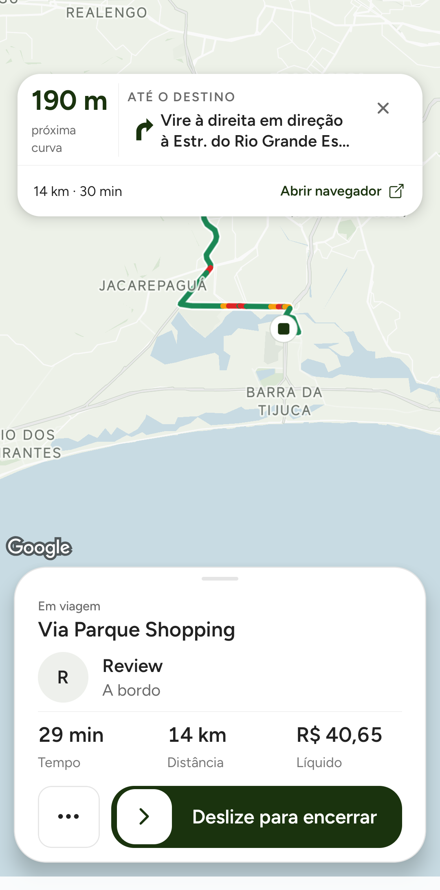
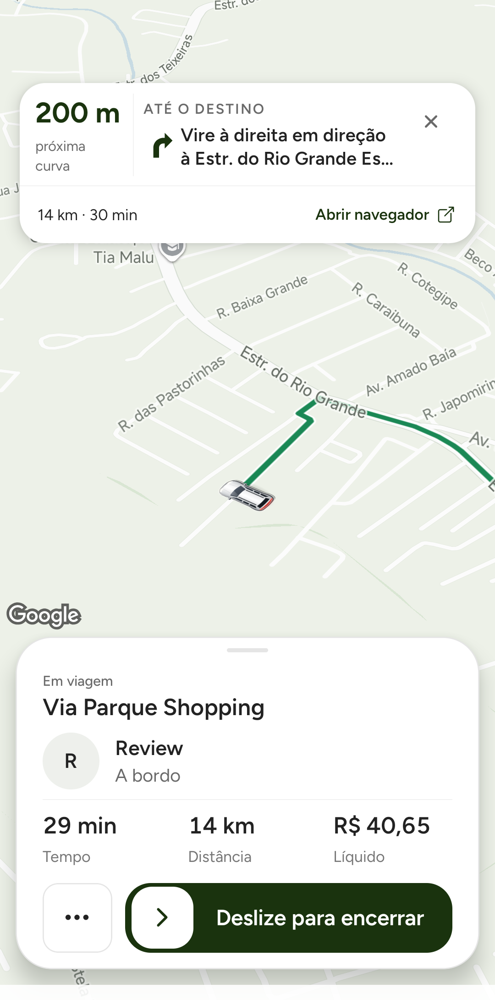
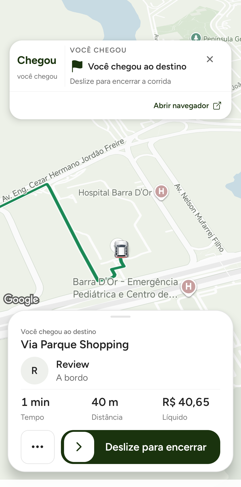
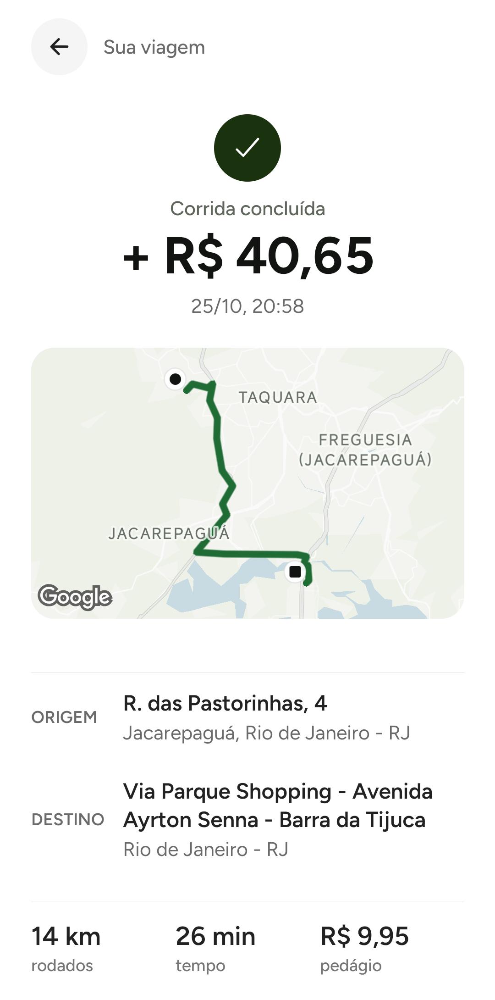

# Comparativo A/B/C da navegação — 25/10/2026

## Objetivo e escopo
Medir o custo no Xiaomi físico com a mesma corrida sandbox e corrigir a perspectiva de condução do motorista. A autorização cobriu uma corrida, um Pix sandbox, os dois perfis QA, alternância local A/B/C, replay do mesmo trecho e limpeza final. Sem publicação.

Alterações: geometria normalizada e medidas reutilizadas sem reter entradas mutáveis; bitmap Android atualizado nativamente sem reconciliar React por cada mudança de ângulo; velocidade preservada da amostra GPS; direção da câmera pela tangente da via, a partir da projeção no segmento, com antecipação de 25 m; inclinação 50°, zoom 16,5/16,2/15,9/15,6 por velocidade com histerese; redução da disputa entre prévia e acompanhamento. Prédios e geometria construída ocultos apenas no mapa de navegação do motorista, para não obstruírem o carro no zoom próximo. Cards e demais telas preservados nesta alteração.

Arquivos: LeafNativeNavigationEngine.js, prototypeRideRuntime.js, PrototypeMapLayer.js, RobotaxiHomeScreen.js e os testes leaf-native-navigation-engine, driver-trip-assist-contract e prototype-map-layer-viewport; caminhos completos rastreados no diff do PR #424.

## Método
A: HEAD anterior às alterações desta rodada (40°, velocidade perdida na normalização). B: apenas cache/bitmap, câmera e velocidade antigas, para isolar a otimização. C: candidato final com todas as alterações descritas. Mesma base nativa (43 entradas DEX/SO idênticas), mesmo certificado QA, JS de produção embutido e OTA desativada. Os APKs são locais; não foram enviados às lojas.

Uma única corrida já IN_PROGRESS, mesmo prefixo da rota (~2.225 m), GPS sandbox nominal 20 m/s/1 Hz. Cada rodada reinicia o Leaf preservando dados, instala sobre a mesma sessão, aquece 25 s, inicia replay e espera 12 s; duas janelas consecutivas de ~20 s por rodada. Capturas e vídeo fora das janelas. Critério previamente proposto: queda repetível de pelo menos 20% na proporção de frames atrasados, sem piora de p95/p99 ou aumento sustentado de CPU/RSS.

Aceitação usa ciclos A3/B3/C3, A4/B4/C4 e A5/B5/C5. A1/A2/B1/B2 são pilotos preservados, excluídos para parear com a fonte final de C. C0/CX/CY são versões intermediárias de câmera/estilo e estão excluídas, com artefatos identificados em JSON. A versão A também tem os cards/carrinho previamente corrigidos; não é uma comparação com versões antigas de loja.

Gfxinfo mede contadores agregados do app; ring buffer de framestats veio vazio e não representa FPS de toda a superfície/GPU do Google Maps. CPU é o processo principal em porcentagem de um núcleo, podendo superar 100%. Ordem sequencial, um aparelho, base nativa QA e temperatura aquecida limitam causalidade/generalização. Não comprova bateria, autonomia, 60 fps, iOS motorista ou deslocamento real.

## Teste isolado do motor
Seis execuções alternadas, Node VM local, geometria de 653 pontos/30 etapas e 120 fixes. Saídas de instruções equivalentes (diferenças intencionais de câmera excluídas). Redução de aproximadamente 69% no tempo do cálculo. Isso não é prova de redução de CPU ou frames no app completo.

## Resultado no aparelho
| Versão | Frames atrasados / total | Proporção | CPU mediana (% de 1 núcleo) | p95 mediano | p99 mediano | RSS final mediano | Temperatura |
| --- | --- | --- | --- | --- | --- | --- | --- |
| A | 723/5657 | 12.78% | 161.5% | 21.5 ms | 27.5 ms | 342.6 MiB | 41–42 °C |
| B | 661/6006 | 11.01% | 155.4% | 21.0 ms | 26.5 ms | 389.7 MiB | 41–43 °C |
| C | 445/6193 | 7.19% | 155.4% | 21.0 ms | 27.5 ms | 314.3 MiB | 41–42 °C |

C vs A: **43,8% menos frames atrasados no agregado**; CPU mediana 3,8% menor, p95 mediano 0,5 ms menor e p99 mediano igual. São resultados desta sessão, não garantias de FPS/bateria. A otimização isolada B ficou em 11,01% contra 12,78% de A, redução de 13,9%; o comparativo não atribui todo o ganho de C ao cache.

| Ciclo | A: atraso / CPU | B: atraso / CPU | C: atraso / CPU |
| --- | --- | --- | --- |
| 3 | 10.20% / 161.5% | 10.40% / 159.3% | 8.54% / 177.5% |
| 4 | 12.20% / 165.2% | 10.10% / 155.0% | 6.33% / 149.3% |
| 5 | 17.49% / 129.4% | 12.76% / 153.8% | 6.56% / 155.2% |

**Sensibilidade, sem excluir dados do resultado principal:** o ciclo 5 teve forte variação, com p95 de A em 23/42 ms e B em 29/23 ms, temperatura entre 41–43 °C. Usando somente ciclos 3 e 4: atraso A 11,21% → C 7,49% (−33,2%); CPU 162,9% → 162,2% (−0,4%); p95 21 → 20,5 ms; p99 26,5 → 27,5 ms. Temperatura é observação; não foi demonstrado que causou os picos.

**Aceitação parcial:** há redução de atraso nas três repetições; não há redução consistente de CPU. C3 teve CPU maior e queda de atraso de apenas 16,3%, abaixo dos 20% propostos; a sensibilidade de p99 piora 1 ms. O critério estrito de melhora repetível sem regressões não foi integralmente cumprido. PR continua draft; não apresentar como problema de desempenho totalmente resolvido.

Um diagnóstico pontual de threads em C, fora das janelas: JS ~39%, RenderThread ~30%, main ~30%, GL-Map ~26%, androidmapsapi ~16%, backend Mali ~13% de um núcleo. Isto indica trabalho relevante de renderização/mapa além do cálculo puro; não é comparação causal entre versões nem perfil detalhado de funções.

## Câmera e evidências
Referência corrigida por Izaak nesta rodada: **Google Maps em modo de condução, com carrinho em primeiro plano**, preservando os cards Leaf. O candidato usa direção da via, carro abaixo do centro da área livre, 50° e zoom por velocidade; isso ainda não deve ser apresentado como reprodução visual aprovada dessa referência.

O comparativo C3/C4/C5 usa APK `170b4ef5aba82310af234cec1193ad05e5f421a80b7cf10a473428577ce231ab`. Depois dele, foram tentados dois ajustes de retomada: reaplicar ao terminar o carregamento nativo e barrar callbacks antigas de prévia. C6/C7 usam APK `dbccad039e6185c40f4eeb87c93e5043d122cc275f082704b0fba8e0ab2439be`; ainda houve abertura afastada em C7. Não foi tratado como resolvido.

O APK final `9c3010c74bc7a4f254ed9799bf6a6f1477bfc81d00c9bf8452abe81d7b1203e6` acrescenta uma reaplicação única após o viewport estabilizar (840 ms), independente de novo GPS; cancela ao sair/background e não roda por posição comum. SHA conferido no APK instalado. A amostra C8 foi interrompida: depois do longo intervalo o loop GPS já tinha encerrado; **não entra no comparativo de desempenho**. A retomada final mostrou mapa próximo e carro visível, seguida do trecho final e chegada. Uma ocorrência não comprova repetibilidade: retomada parado/orientação e enquadramento Google Maps permanecem sem aceite visual final. O ganho medido de C3/C4/C5 não valida automaticamente o último ajuste de ciclo de vida.

[Comparativo A/B/C e hashes](evidence/driver-navigation-abc-2026-10-25.json) · [Benchmark isolado](evidence/driver-navigation-engine-benchmark-2026-10-25.json) · [Vídeo físico do trecho final](evidence/driver-navigation-final-destination-2026-10-25.mp4).

## Corrida e limpeza
Pedido `booking_1792947972712_3tEQ8pQ2QzeWbMKhLGsXHHhnOGL2`: um Pix sandbox de R$ 42,14, aceite 14:06:15 e início 14:08:01 (São Paulo). Foram repetidos prefixos da geometria; isto não é um percurso comercial contínuo. A corrida permaneceu aberta durante um longo intervalo; o loop GPS parou no limite de segurança e a janela temporária expirou. Na retomada às 20:55, isso foi detectado e a medição interrompida descartada. Sem novo pedido ou pagamento, foi reproduzido somente o trecho final existente (~456 m) e concluída pelo slider normal às **20:58:02**, `SERVER_DESTINATION_COMPLETION`. Não houve escrita manual de status financeiro.

Recibo backend R$ 42,14 passageiro / R$ 40,65 motorista, Leaf R$ 0,99, Pix R$ 0,50 e pedágio explícito R$ 9,95. Settlement `posted`, débito = crédito = 4.214 centavos e balanceado. Counter sandbox Redis/Firestore **9 → 10**, ID contado uma vez; operacional permanece 0. A hash de pagamento continua `in_holding`; não é prova de payout. O iPhone foi usado na criação original; a automação dele não estava disponível no fechamento, então o recibo passageiro foi conferido no backend, sem afirmar conferência visual final nesse aparelho.

Às **20:58:41 de São Paulo**, ambos sem corrida ativa, motorista offline, janela temporária ausente (já expirada, nenhuma janela alheia removida), GPS loop parado e serviço mock ausente; sessões preservadas. Sem senha, OTP, pm clear ou desinstalação. [Resumo final verificável](evidence/driver-navigation-final-qa-2026-10-25.json).

## Testes, riscos e reversão
229 suítes e **1.868 testes mobile passaram** após o ajuste de retomada. A execução padrão local falhou antes de rodar testes por duas instâncias React Native via symlink (`__fbBatchedBridgeConfig`); foi repetida pelo mesmo script npm com resolver local que fixa uma única instância React/React Native, `--watchman=false --runInBand`. Resolver permanece fora do Git. Guards mobile, governança, scan tracked-only, secret guard e diff check passaram; checagens finais repetidas no registro. O teste adicional dispara uma callback antiga de map-loaded depois da troca de proprietário da câmera, para garantir que não refaça o fit da prévia.

Rollback: reverter o commit desta rodada restaura os parâmetros/cálculos anteriores, preservando carrinho e cards dos commits anteriores. APK A local preservado para reinstalação com -r, sem limpar dados. Sem merge, deploy, OTA, Sentry ou lojas. Fora do escopo: passageiro, banner externo, resto da interface, backend/socket, regras financeiras/KYC, novas dependências e frequência de APIs. Primeira corrida operacional da promoção ainda exige passageiro/Pix reais.

Artefatos brutos locais: `~/.codex/visualizations/2026/10/22/01a16498-a3ec-7093-bfae-c4c373c52628/navigation-performance-fix-2026-10-25/`. O comparativo principal está congelado nos ciclos 3/4/5; pilotos e versões intermediárias permanecem guardados.
