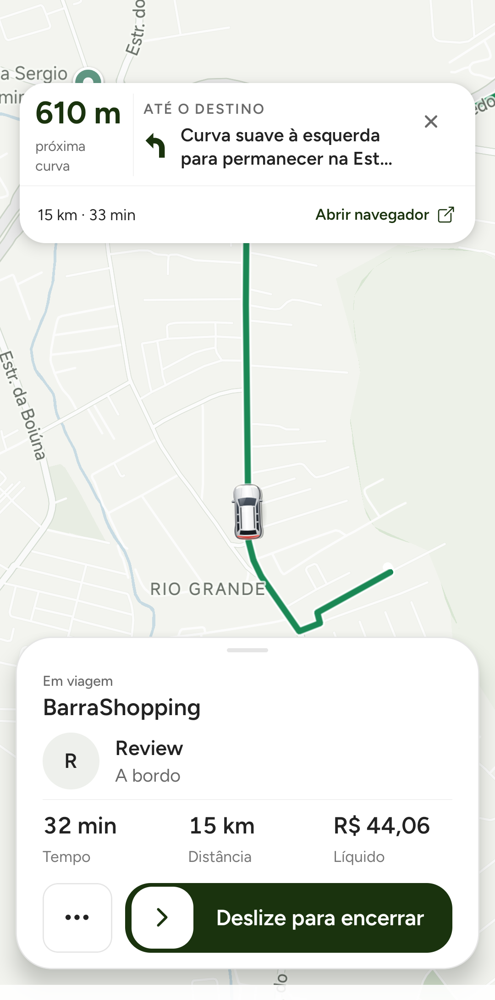

# Motorista: carrinho completo, alinhamento e mapa mais visível

## Objetivo e escopo concluído

Atender aos três ajustes pedidos por Izaak: eliminar o recorte do carrinho no mapa do motorista, corrigir seu centro em relação à rota e compactar os cards superior/inferior durante a navegação. Branch `codex/driver-navigation-map-visibility`, empilhada sobre #423 (`97457e576`).

## Implementação e arquivos

- `mobile-app/src/components/prototype/PrototypeMapLayer.js`: no Android do motorista, o desenho existente é capturado em PNG transparente completo, na densidade do aparelho, e usado como imagem do marcador nativo. Âncora central `(0.5, 0.5)`, posição/interpolação/projeção e rotação continuam no Google Maps nativo. Não se posiciona um overlay pelo movimento da câmera. A captura acontece ao montar/carregar a arte, não em cada GPS/frame; uma geração impede resultado assíncrono obsoleto após troca de arte/desmontagem. Cor, formato e arte remota continuam no mesmo caminho de desenho. Falha de captura conserva o marcador anterior. A tela do passageiro conserva seu caminho de renderização.
- `mobile-app/src/screens/prototype/home/LeafNativeNavigationBanner.js`: linha principal mínima 108 → 72 dp, menos padding, instrução em duas linhas e tipografia 14/18. Rodapé mantém botão de 44 dp, sem padding vertical redundante. Reserva inicial 168 → 120 dp; oclusão/câmera continuam usando altura real medida por `onLayout`.
- `mobile-app/src/screens/prototype/home/DriverLiveRideOverlay.js`: o card realmente usado na Home do motorista recebeu título 18/23, fase 11/14, menos espaços de handle/identidade/métricas/ações e padding. Mantém identidade, ETA, distância, líquido, expansão/recolhimento, ações e slider de encerramento. O estado de interrupção conserva seu componente de resumo. Não muda estilos compartilhados do passageiro.
- Testes: `prototype-map-layer-viewport.test.js` e `leaf-native-navigation-banner.test.js`. Este relatório e a captura abaixo completam a evidência versionada.

A tentativa inicial de fixar somente largura/altura do Marker **não resolveu** o recorte no Xiaomi e não foi aceita como validação. O renderer Android de Maps tem fallback de bitmap customizado de 100 px, enquanto a arte ativa mede 56 dp (~157 px neste aparelho). O caminho de imagem completa eliminou o recorte observado e a assimetria em torno da âncora. Sem patch de dependência ou alteração nativa.

`react-native-view-shot` já era dependência do projeto e já estava no binário de QA. Nenhuma dependência, arquivo nativo, serviço, chamada paga ou job novo foi adicionado. Uma captura RGBA de 157×157 representa aproximadamente 96 KiB de pixels; isso não é uma medição completa do processo ou prova de autonomia. A iluminação do bitmap do motorista Android fica fixa na arte gerada; a rotação do carro no mapa continua contínua. Não há recaptura para cada bucket de heading.

## Evidência visual física

Captura do Xiaomi físico, Google Maps real, build local, sessão e Pix sandbox, GPS simulado sobre trecho da rota recebida. Sem mock de UI. Somente status/navigation bars do sistema foram excluídos; o conteúdo Leaf não foi retocado.

Na captura: o centro do carro permanece sobre o segmento verde, o veículo está inteiro e a região entre os cards fica livre. Foram conferidos três pontos em movimento, inclusive mudança de direção. Isso é evidência visual de enquadramento/alinhamento; **não é aprovação de FPS/fluidez** nem substitui o estudo pendente de #423.

Com título em uma linha neste Xiaomi 1080×2400 / 450 dpi, o topo do card inferior passou de aproximadamente y=1386 na captura anterior para y=1511 na nova, mantendo a borda inferior: cerca de 125 px (~44 dp) devolvidos ao mapa. Comparação aproximada entre capturas de estados semelhantes, não benchmark controlado. O banner superior mediu aproximadamente 124 dp na captura com instrução em duas linhas; sua altura permanece adaptativa.

Evidência bruta fora do Git: `~/.codex/visualizations/2026/10/22/01a16498-a3ec-7093-bfae-c4c373c52628/driver-navigation-visibility-2026-10-24/`: `motion-01.png`, `motion-02.png`, `motion-03.png`, `expanded-actions.png`, `compact-restored.png`, `destination-restored.png`, leituras e reconciliação filtradas. A captura versionada é uma cópia de `motion-03.png`.

## Testes executados

- Suíte mobile completa: **229 suítes / 1.850 testes passaram**. Comando `npm --prefix mobile-app run test:unit -- --watchman=false --resolver=<resolver local de QA existente> --runInBand`; log local `/tmp/leaf-driver-visibility-full-tests.log`.
- Novo teste renderiza o caminho Android com ref de view simulado: captura completa na densidade do aparelho, troca para `Marker.image`, âncora central, remoção da view temporária e ausência de nova captura após GPS/interpolação. Evidência unitária com mocks, separada das capturas físicas.
- Testes existentes de projeção/interpolação, fallback imperativo, pausa em segundo plano, UI de ações e oclusão dinâmica continuaram passando. O teste do banner acompanha a nova reserva inicial; mantém atualização pelo layout real.
- Governança, guards de produção mobile, secret guard backend, varredura de segredos e `git diff --check` executados.

## QA e reconciliação

Segunda e última corrida do ciclo de até duas já autorizado: `booking_1792853647957_3tEQ8pQ2QzeWbMKhLGsXHHhnOGL2`. Android motorista e iPhone passageiro QA. Busca/estimativa e rota de embarque pelos gatilhos normais; nenhuma chamada de rota forçada. Não houve terceiro pedido.

- Aceite, chegada e início pelos controles do aplicativo. Houve reconexão e alerta de indisponibilidade no retorno de chegada; o servidor registrou `ARRIVED` e a UI reconciliou antes do início. Não foi sobrescrito estado por API. A conexão voltou a oscilar em segundo plano e também durante a saída offline. Esse problema de runtime não é considerado resolvido por este diff visual.
- Foram percorridos trechos da geometria com GPS simulado, depois reposicionado o QA para aproximação final de ~400 m no mesmo destino. Não é percurso comercial integral nem medição de tempo/distância reais.
- Encerramento normal pelo slider às 14:58Z; servidor `COMPLETED` e qualificação `SERVER_DESTINATION_COMPLETION`. Redis e Firestore sandbox **7 → 8**, operacional continua **0**. Passageiro recebeu o recibo e voltou ao início.
- Pix sandbox inicial 4.555 centavos. Backend final retirou o pedágio não percorrido nesta simulação: total final 3.560, motorista 3.411, Leaf 99 e Pix 50. Reembolso parcial sandbox de 995 com `REFUNDED_PARTIAL`/`refundLedgerStatus=recorded`. Ledger `refund_processed` de 995 e `ride_settlement` de 3.560, ambos postados e balanceados. Sem mudança financeira ou estorno manual. Ver `payment-reconciliation.json`.
- GPS mock parado; serviço ausente. O aplicativo apresentou timeout ao solicitar offline; foi parado sem apagar dados, com a corrida já concluída. Após o intervalo, às 02:46Z de 25/10 (23:46 de 24/10 em São Paulo), `cleanup.json` confirmou ambos os perfis sem corrida ativa, motorista offline e janela temporária ausente por expiração natural; nenhuma janela alheia foi removida.

## Build, riscos, reversão e fora do escopo

APK local Android 1.0.11 (144), OTA desativada, assinatura de QA existente, SHA-256 `5191dbff903ed1b9c14ee61c31859ba7b75cb494840c2cce02edc33659653b24`; bundle `01bcfe7beacadfc38723de9d2d59a2538a479baefe573ed3e4ddd769a55a3475`. Mesmos 43 DEX/bibliotecas nativas do artefato de QA base. iPhone passageiro permaneceu no build local anterior; não foi instalado novo iOS nesta tarefa. Layout do motorista iOS não foi validado fisicamente.

Limites: instruções/endereços longos podem aparecer com reticências; texto completo continua no componente/acessibilidade e o navegador externo permanece disponível. Não houve nova medição de bateria ou benchmark comparativo de FPS. Se a captura de arte falhar, mantém-se o renderer anterior; a validação física cobre o veículo padrão branco e a captura de limpeza também mostrou veículo preto inteiro. Moto e campanhas não foram validadas fisicamente neste ciclo.

Reversão: reverter o commit deste PR e reinstalar o APK de QA anterior por atualização, preservando sessão. Nenhum merge, deploy, OTA, upload Sentry ou envio às lojas. Fora do escopo: passageiro, notificações externas, backend/socket, tarifa/Pix/promoção/KYC, provedores/frequência de consultas e demais interfaces. As pendências de desempenho/CI de #423 continuam separadas.
