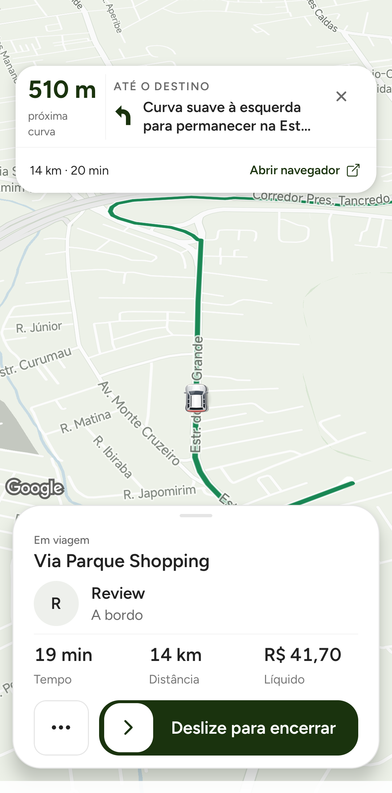
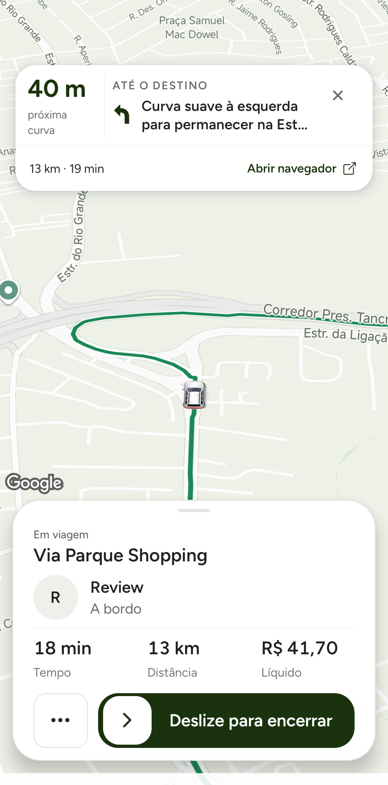
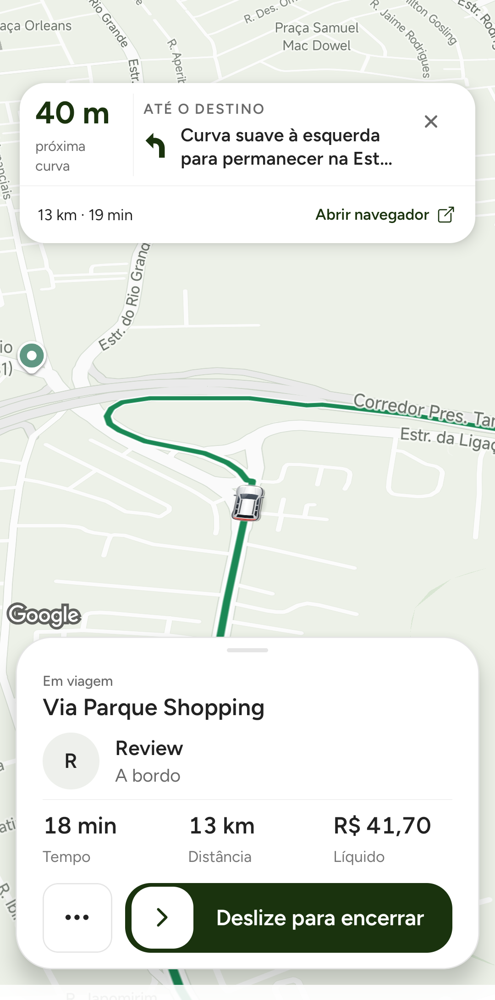
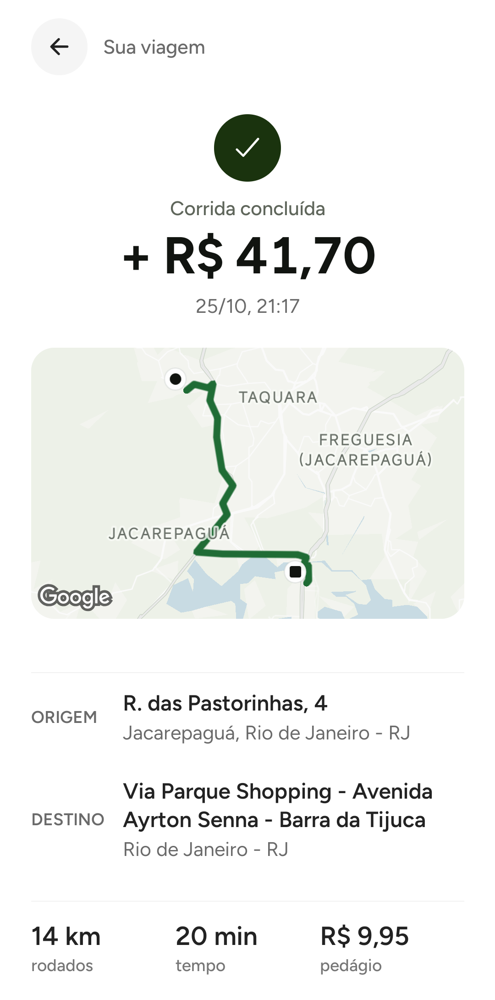

# Validação final da câmera com referência Google Maps — 25/10/2026

## Objetivo e resultado
Validar no Xiaomi físico o APK final da câmera do motorista, com carrinho em primeiro plano e mais via à frente, tomando o Google Maps em condução como referência. **Duas reaberturas parado durante IN_PROGRESS terminaram no enquadramento próximo, com carro inteiro e rota à frente.** Aproximação e viagem gravadas. O cenário de mapa parado em visão da cidade não foi reproduzido nessas duas verificações após estabilização; não é garantia universal nem prova de ausência de saltos transitórios ao abrir. A escolha visual final do enquadramento permanece com Izaak; não afirmar igualdade com o produto Google Maps.

APK SHA-256 `9c3010c74bc7a4f254ed9799bf6a6f1477bfc81d00c9bf8452abe81d7b1203e6`, conferido no arquivo instalado; fonte funcional e938c7e9f, mesmo APK final do relatório A/B/C. OTA desativada. Xiaomi motorista / iPhone passageiro, sessões QA existentes. **Nenhum código de produto alterado durante esta rodada.**

## Escopo, método e evidência
Uma corrida sandbox autorizada expressamente por Izaak. A primeira cobrança expirou sem pagamento durante o intervalo: tentativa de confirmação retornou409. A nova cotação pelo fluxo normal criou outro intent; somente esse foi confirmado200 uma vez, R$43,19. Não houve segundo pagamento sandbox bem-sucedido. Os perfis foram verificados como qa-test-users-sandbox-durable; janela temporária renovada apenas para o motorista QA e removida ao terminar.

Pedido `booking_1792973559814_3tEQ8pQ2QzeWbMKhLGsXHHhnOGL2`. Aceite21:12:43, chegada confirmada, início21:14:23 e conclusão normal21:17:50, horário de São Paulo. Foram usados GPS QA: aproximação curta de~100m até o ponto, prefixo de1.074m da geometria recebida, posição fixa para reabertura e trecho final de~456m. Há salto entre prefixo e trecho final: **não é replay integral contínuo nem deslocamento real**. Sem forçar novas consultas de rota. Preferência existente abriu o navegador externo no aceite/início; Leaf trazido de volta sem inspecionar outros apps.

Uma reabertura na aproximação e duas na viagem, com posição fixa. Durante a viagem, após estabilização, ambas preservaram carro visível abaixo do centro da área livre, direção da via e espaço para rota à frente; sem visão geral da cidade nas capturas. Isso valida a retomada nestas condições e não outras densidades, iPhone motorista ou GPS real. Teste não incluiu gesto manual de pan/retomada.

[Vídeo físico em movimento](evidence/google-camera-final-moving-2026-10-25.mp4) · [Vídeo parado após segunda reabertura](evidence/google-camera-final-parked-2026-10-25.mp4) · [JSON verificável](evidence/google-camera-final-qa-2026-10-25.json). São capturas do Leaf físico, sem mockup. Vídeos brutos podem incluir barras do próprio sistema. Artefatos completos locais em `~/.codex/visualizations/2026/10/22/01a16498-a3ec-7093-bfae-c4c373c52628/google-camera-final-qa-2026-10-25/`.

## Desempenho e aceitação
Uma janela adicional limpa de20,4s sem gravação/captura: 26/1.077 frames atrasados (**2,41%**), p95 **16ms**, CPU **140,8% de um núcleo**. A primeira janela coincidiu parcialmente com uma gravação e foi **excluída**, arquivos marcados excluded-recording-overlap fora do Git. Não usar a janela limpa como comparação contra A: velocidade/fase/temperatura diferem, só uma amostra e gfxinfo não cobre todo Maps/GPU. Não comprova60fps, autonomia ou redução sustentada de CPU. O comparativo controlado e suas limitações continuam em [DRIVER_NAVIGATION_ABC_2026-10-25.md](DRIVER_NAVIGATION_ABC_2026-10-25.md).

Aceitação desta rodada: fluxo sandbox e duas retomadas finais aprovados nas condições verificadas; sem aceite de fidelidade visual ao Google Maps por Izaak e sem aprovação de desempenho como totalmente resolvido. PR permanece draft.

## Recibos, contador e limpeza
Recibos: passageiro R$43,19, motorista R$41,70; conferidos no backend e telas, incluindo o recibo passageiro no iPhone. Pedágio R$9,95 explícito, Leaf R$0,99 e Pix R$0,50. Settlementposted, débito=crédito=4.319centavos, balanceado. Conclusão SERVER_DESTINATION_COMPLETION; contador sandbox Redis/Firestore **10→11**, ID contado uma vez; operacional permanece0. Hash de pagamento in_holding não prova payout ou saque.

Às **21:18:34 de São Paulo**, ambos sem corrida ativa e motorista offline. Janela própria removida por compare-and-delete, ausente após remoção; serviço mockGPS ausente e loop parado. Ambos voltaram ao mapa Leaf, sessões preservadas. Sem senha,OTP,pm clear ou desinstalação.

## Arquivos, testes, riscos, reversão e fora do escopo
Arquivos desta rodada: este relatório, complemento de status no relatório A/B/C e JSON/mídia google-camera-final-* em docs/validation/evidence. Produto permaneceu no mesmo código dos **229 suites/1.868 testes** já aprovados localmente; não repetidos porque não houve mudança funcional. CI em e938c7e9f: mobile, backend, Firebase, governança e segurança passaram; dashboard falhou na instalação do Chromium, antes de lint/build/smoke: Playwright1.60.0 sem suporte ao runner ubuntu26.04-x64. Não é CI inteiramente verde; correção de runner fora deste escopo.

Riscos: uma sessão/um Xiaomi, GPS simulado, sem deslocamento real; estabilidade prolongada/bateria/iOS motorista não comprovados. Rollback funcional: reverter e938c7e9f preserva os cards/carrinho anteriores; APK A permanece guardado para reinstalação sem apagar dados. Este commit só documenta QA e não muda o runtime.

Fora do escopo preservado: cards, demais telas, passageiro, banner externo, backend/socket, finanças/KYC, dependências e frequência de APIs. Sem merge, deploy, OTA, Sentry, build nativo ou lojas. Primeira corrida operacional da promoção ainda depende de passageiro/Pix reais.
